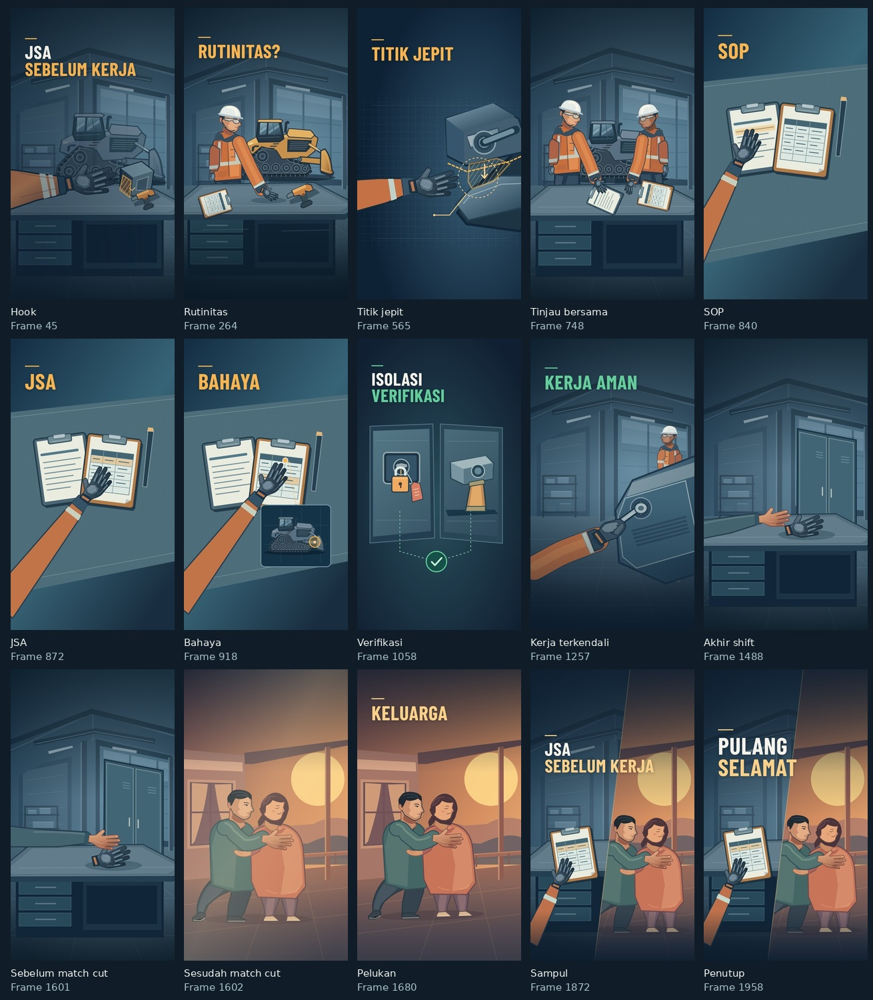

# Keselamatan Tangan dan Jari

Pratinjau Gate B menampilkan tujuh adegan JSA dalam Bahasa Indonesia. Komposisi Remotion `KeselamatanTangan` berdurasi 66 detik pada 30 fps dengan kanvas 1080 × 1920.

- Putar atau unduh versi tinjauan berukuran 360 × 640. [Klip WebM](preview/preview-360x640.webm)
- Tinjau 42 frame pada ukuran komposisi atau ponsel. [Frame 1080 × 1920](preview/stills) · [Versi 360 × 640](preview/ponsel)
- Periksa judul dan komposisi wajah pada kandidat sampul. [Frame 1872](preview/stills/element-1872.png)
- Cocokkan visual dengan VO dan poin tinjauan HSES. [Storyboard](../../projects/batubara-swabakar/storyboard.md) · [Laporan QA](../../projects/batubara-swabakar/qa-report.md)

