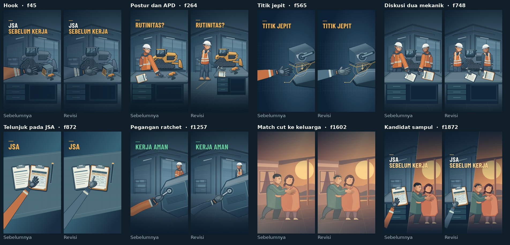

# Revisi karakter | Keselamatan Tangan dan Jari

**Gate B · `KeselamatanTanganRevisiKarakter` · 1080 × 1920 · 30 fps · 1.980 frame**

Tinjau profil kedua mekanik, posisi tangan pada JSA dan ratchet, serta kesinambungan tangan saat berpindah dari bengkel ke pelukan. [WebM 540 × 960](preview-540x960.webm) · [Rangkaian pose](pose-gerak.jpg) · [Frame resolusi penuh](stills)

## Perlakuan karakter

- Wajah tiga perempat, leher, dan bahu digambar ulang. Helm putih, kacamata keselamatan, rompi hi-vis dengan pita reflektif, pakaian kerja lengan panjang, sarung tangan, dan sepatu keselamatan terlihat sesuai ukuran shot.
- Pada shot rutinitas, kedua sepatu menapak saat badan bergeser ke arah alat. Letak siku dihitung dari bahu dan pergelangan dengan panjang segmen tetap. Pergeseran pandangan, jeda tangan, dan kedipan dibangun dari frame.
- Bentuk tangan menyesuaikan tindakan. Telunjuk menelusuri JSA, jari melengkung di sekitar gagang ratchet, dan tangan tanpa sarung beristirahat di bahu pada match cut. Penanda titik jepit dan urutan visual verifikasi mengikuti storyboard. [Storyboard](../../projects/batubara-swabakar/storyboard.md)

## Preservasi sumber dan QA

Sebelum perubahan dimulai, kesesuaian delapan TSX di `src/keselamatan-tangan/`, `src/Root.tsx`, serta WAV dan naskah diperiksa terhadap cabang GitHub Gate B pada `c22c0118f98580139fa774522928c618287c0012` dan `main` pada `29ec87bdc94f05ff3a3053e9b9aa25a0b995a280`. Kedua versi tersedia sebagai komposisi terpisah. [Sumber awal Gate B](https://github.com/layudhi/motion-graphic-studio/tree/c22c0118f98580139fa774522928c618287c0012/src/keselamatan-tangan)

| Pemeriksaan | Bukti |
| --- | --- |
| Komposisi sebelumnya | 42 frame pembanding cocok per piksel. Sebanyak 40 dibandingkan dengan paket Gate B dan 2 dirender ulang dari sumber `main` yang terisolasi untuk pembanding. Pemeriksaan Git mencakup `MiningSafetyDemo`, `BatubaraSwabakar`, dan 13 Official Remotion Skills. |
| APD dan anatomi | Frame 264 memperlihatkan helm, kacamata, rompi, siku, dan kontak sepatu. Frame 748 memperlihatkan kedua mekanik. Detail sarung tangan diperiksa pada 565, 872, dan 1257. |
| Kesinambungan | Sampel pose awal, tengah, dan akhir ditinjau dari 46 PNG, versi ponsel, dan 20 frame yang didekode dari WebM. Frame 1601 dan 1602 menjadi pasangan match cut. Delapan frame resolusi penuh ada di paket ini. |
| Media | `ffprobe` mengonfirmasi 540 × 960, 30 fps, dan 1.980 frame pada WebM. Audio PCM hasil decode identik dengan pratinjau Gate B sebelumnya, dengan durasi 66,000 detik. Cue kalimat berstatus provisional sampai pemeriksaan dengar. |
| Validasi kode | `npm run lint`, `git diff --check`, dan penemuan komposisi Remotion. Chromium lokal digunakan untuk render timelinenya. |

Validasi APD dan pengendalian pada unit sebenarnya menjadi bagian tinjauan HSES. Mohon persetujuan pratinjau revisi Gate B.
